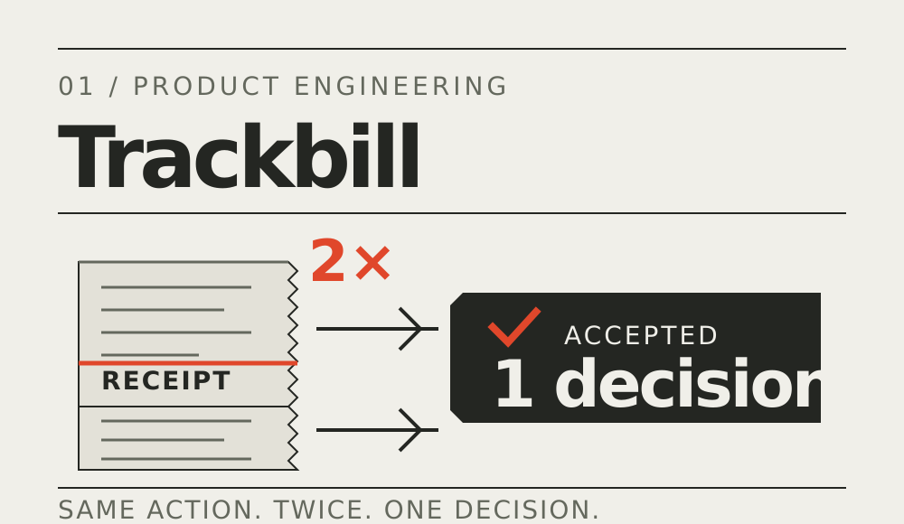
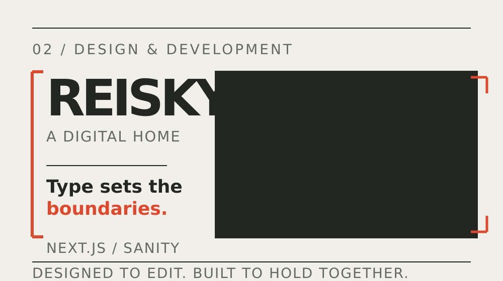
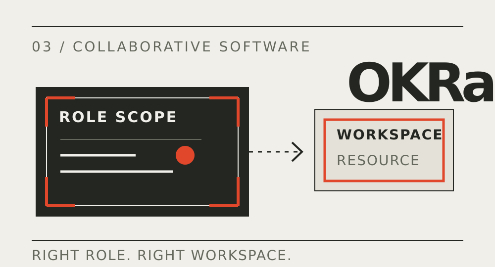
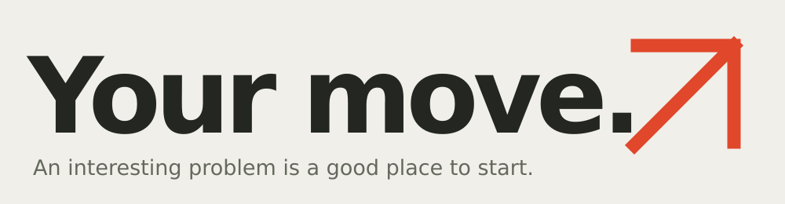

<a href="https://jnwync.vercel.app/">
  <picture>
    <source media="(prefers-color-scheme: dark)" srcset="./assets/redline-hero-dark.svg">
    
  </picture>
</a>

**Jon Wayne Cabusbusan · Full-stack web + mobile engineer · Iloilo, Philippines**

I make things people click, tap, edit, and occasionally press twice. That last part gets interesting.

React, Next.js, TypeScript, Node.js, and React Native are my usual tools. I use AI to explore and iterate; the decisions, review, and verification stay with me.

[Explore my work](https://jnwync.vercel.app/#projects) · [Run a small experiment](./lab/README.md) · [Resume](https://jnwync.vercel.app/cv.pdf) · [Email](mailto:jonwayne.cabusbusan@gmail.com)

 

<a href="https://jnwync.vercel.app/work/trackbill">
  <picture>
    <source media="(prefers-color-scheme: dark)" srcset="./assets/trackbill-dark.svg">
    
  </picture>
</a>

### Same receipt. Same action. Again.

For **[Trackbill](https://jnwync.vercel.app/work/trackbill)**, I worked on making one valid Split/No decision stick—even when an action arrived late or arrived again. Contract product engineering for **Inertia**, across Next.js, Express/Prisma, and Expo/React Native. [Visit the product ↗](https://trackbill.ai)

  
Go on. Press it twice.

  The work used atomic state commits, duplicate/stale rejection, localized feedback, and regression coverage across Meta and Evolution webhook paths.

  Here's a small, original teaching model of the rule. Same input, second delivery; the first decision stays put.

  | Delivery | Result |
  | :-- | :-- |
  | `split / tap-1` | **accepted** |
  | `split / tap-1` | duplicate |
  | `keep / tap-2` | stale |

  `keep` means declining the split. This is a sequential model; distributed acceptance needs a transaction or compare-and-set at the persistence boundary.

  [Run it](./lab/README.md) · [Read the source](./lab/receipt-action.mjs) · [Challenge the tests](./lab/receipt-action.test.mjs)

 

<a href="https://jnwync.vercel.app/work/reisky">
  <picture>
    <source media="(prefers-color-scheme: dark)" srcset="./assets/reisky-dark.svg">
    
  </picture>
</a>

### The editor changes things. Good.

I designed and built **[Reisky Martial Arts](https://jnwync.vercel.app/work/reisky)** a digital home in Next.js and TypeScript. Behind the page: a typed bridge from Sanity content to application models, so content can change without teaching every component how the CMS works. **Freelance design + development.** [Visit the website ↗](https://reisky.vercel.app)

  
Does the page have to speak GROQ?

  The content layer does. The page gets application types.

  TypeGen feeds unit-tested mappers that translate Sanity content into domain types. A feature flag selects Sanity or static data behind the same contract. It's an explicit switch, rather than automatic outage recovery.

 

<a href="https://jnwync.vercel.app/work/okra">
  <picture>
    <source media="(prefers-color-scheme: dark)" srcset="./assets/okra-dark.svg">
    
  </picture>
</a>

### A shared board. Some very unshared permissions.

For **[OKRa](https://jnwync.vercel.app/work/okra)**, I worked on workspace-scoped access and realtime updates, with shared TypeScript/Zod contracts connecting the React and API layers. **Project-based full-stack work at Mashup Technology Ventures**, using PostgreSQL and Drizzle.

  
“Everyone can see it” needs a few more conditions.

  Role- and workspace-scoped permissions protect the workflows. Auth.js sessions and route protection handle identity; server-sent events with PostgreSQL LISTEN/NOTIFY carry board updates.

  The useful part is where those pieces meet: the right person, in the right workspace, receiving the right update.

 

<a href="mailto:jonwayne.cabusbusan@gmail.com">
  <picture>
    <source media="(prefers-color-scheme: dark)" srcset="./assets/redline-close-dark.svg">
    
  </picture>
</a>

Got a good “what happens if…”? I'd like to hear it.

[jonwayne.cabusbusan@gmail.com](mailto:jonwayne.cabusbusan@gmail.com) · [LinkedIn](https://www.linkedin.com/in/jnwync/) · [More work](https://jnwync.vercel.app/)
