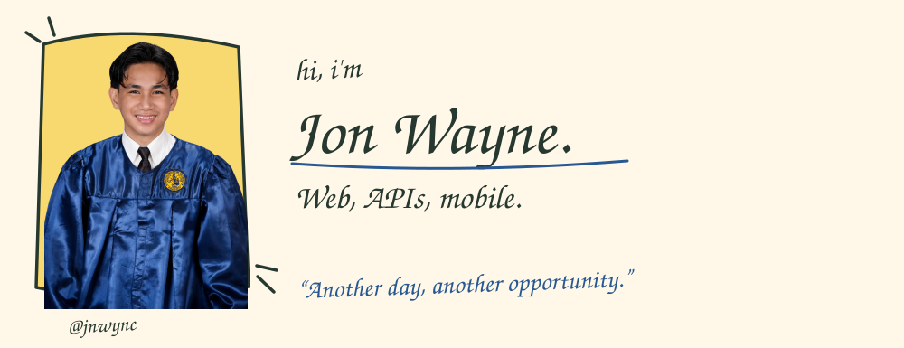
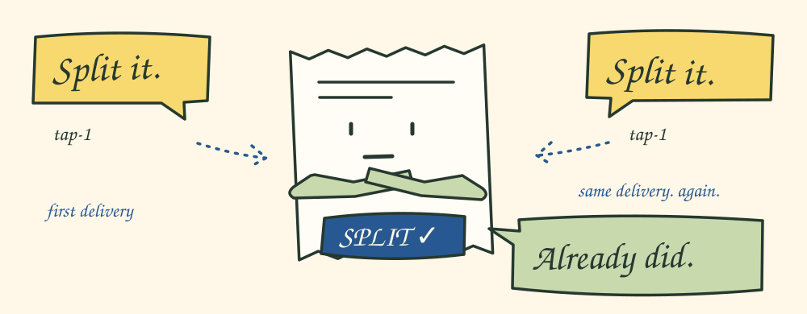
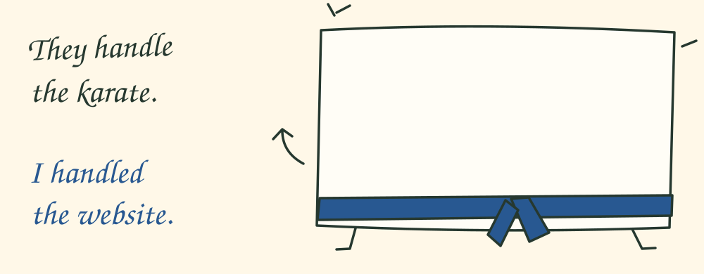
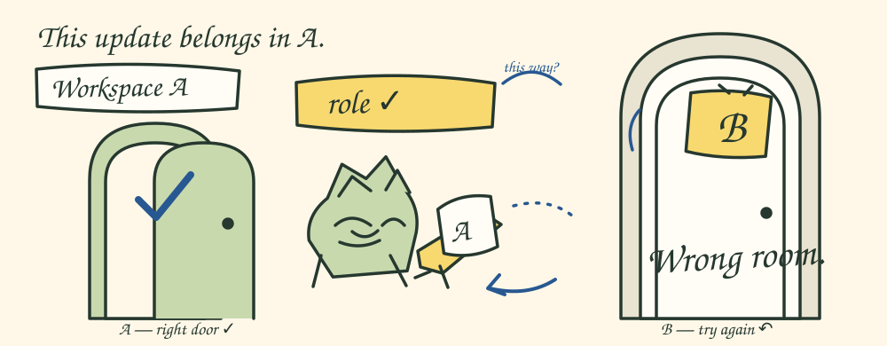

I'm **Jon Wayne Cabusbusan**, a full-stack web and mobile engineer in **Iloilo, Philippines**. I build with React, Next.js, TypeScript, Node.js, and React Native.

Some of my work, with pictures.

[Portfolio](https://jnwync.vercel.app/) · [Resume](https://jnwync.vercel.app/cv.pdf) · [Email](mailto:jonwayne.cabusbusan@gmail.com)

### A receipt that remembers

I worked on **[Trackbill](https://jnwync.vercel.app/work/trackbill)** for **Inertia**, across Next.js, Express/Prisma, and Expo/React Native. One part of that contract work: making one valid Split/No decision stick when an action arrives late or arrives again.

  
Send the same action again.

  Here's a small model of the rule, written for this profile:

  | Delivery | Result |
  | :-- | :-- |
  | `split / tap-1` | **accepted** |
  | `split / tap-1` | duplicate |
  | `keep / tap-2` | stale |

  `keep` means declining the split. [Run it](./lab/README.md), [read the source](./lab/receipt-action.mjs), or [try the tests](./lab/receipt-action.test.mjs).

  The production work used atomic state commits, duplicate/stale rejection, localized feedback, and regression coverage across Meta and Evolution webhook paths. This little model is sequential; distributed acceptance needs a transaction or compare-and-set at the persistence boundary.

[Trackbill case study ↗](https://jnwync.vercel.app/work/trackbill) · [Product](https://trackbill.ai)

### Reisky Martial Arts

**[Reisky Martial Arts](https://jnwync.vercel.app/work/reisky)** teaches karate and Filipino martial arts. I designed and built their website in Next.js and TypeScript, with Sanity for content. **Freelance design + development.**

  
Under the belt.

  TypeGen feeds unit-tested mappers that turn Sanity content into application types. The pages get the types they need; the CMS queries stay in the content layer.

  A feature flag explicitly selects Sanity or static data behind the same contract. It isn't automatic outage recovery.

[Reisky case study ↗](https://jnwync.vercel.app/work/reisky) · [Website](https://reisky.vercel.app)

### A board with a sense of boundaries

For **[OKRa](https://jnwync.vercel.app/work/okra)** at **Mashup Technology Ventures**, I worked on workspace-scoped access and realtime board updates. Project-based full-stack work with React, shared TypeScript/Zod contracts, and PostgreSQL/Drizzle.

  
The door has a backend.

  Auth.js sessions and route protection handle identity. Role and workspace checks govern access; server-sent events with PostgreSQL LISTEN/NOTIFY carry board updates. Shared validation contracts keep the React and API layers aligned.

[OKRa case study ↗](https://jnwync.vercel.app/work/okra)

---

I also use AI-assisted development workflows. If you're curious about the code, start with the [receipt experiment](./lab/README.md).

Have a web or mobile project in mind? [Say hi](mailto:jonwayne.cabusbusan@gmail.com).

[jonwayne.cabusbusan@gmail.com](mailto:jonwayne.cabusbusan@gmail.com) · [LinkedIn](https://www.linkedin.com/in/jnwync/) · [More work](https://jnwync.vercel.app/)
