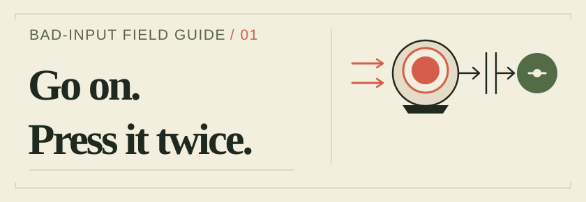

# jnwync.

**Jon Wayne Cabusbusan · Full-stack web + mobile · Iloilo, Philippines**

[Work](https://jnwync.vercel.app/#projects) · [Resume](https://jnwync.vercel.app/cv.pdf) · [Email](mailto:jonwayne.cabusbusan@gmail.com)

<picture>
  <source media="(prefers-color-scheme: dark)" srcset="./assets/field-guide-dark.svg">
  
</picture>

A small field guide to perfectly reasonable things users do next.

### 01 · Same receipt. Same action. Again.

Receipt actions can arrive late or arrive again. I worked on making one valid Split/No decision stick—and rejecting the repeat.

From **[Trackbill](https://jnwync.vercel.app/work/trackbill)**, contract product engineering for Inertia across Next.js, Express/Prisma, and Expo. [Product](https://trackbill.ai)

<details>
  <summary>Okay, send it again.</summary>

  The actual work used atomic state commits, stale/duplicate rejection, localized feedback, and regression coverage across Meta and Evolution webhook paths.

  I made a small, runnable sketch of the rule for this profile:

  ```text
  split / tap-1 -> accepted
  split / tap-1 -> duplicate
  keep / tap-2 -> stale
  ```

  Here, `keep` means declining the split.

  [Run the sketch](./lab/README.md) · [Read the source](./lab/receipt-action.mjs) · [Inspect the tests](./lab/receipt-action.test.mjs)

  This model is sequential; production atomicity belongs at the persistence boundary. The sketch's documentation explains that limit.
</details>

### 02 · The editor changes things. Good.

Editing the content shouldn't require editing the interface. I built a typed bridge between the studio's Sanity content and the application's domain models, with an explicit choice of CMS or static data.

From **[Reisky Martial Arts](https://jnwync.vercel.app/work/reisky)**, a Next.js/TypeScript website I designed and built as a freelance project. [Website](https://reisky.vercel.app)

<details>
  <summary>Does the page have to speak GROQ?</summary>

  The content layer does. The page gets application types.

  TypeGen feeds unit-tested mappers that translate Sanity content into domain types. A feature flag selects Sanity or static data behind the same contract. The switch is explicit; it doesn't promise automatic outage recovery.
</details>

### 03 · New workspace. Different rules.

Sharing a board shouldn't mean sharing every permission. I worked on workspace-scoped access and realtime updates, with shared validation contracts keeping the React and API layers aligned.

From **[OKRa](https://jnwync.vercel.app/work/okra)**, project-based full-stack work at Mashup Technology Ventures using TypeScript/Zod and PostgreSQL/Drizzle.

<details>
  <summary>“Everyone can see it” isn't a permission model.</summary>

  Role- and workspace-scoped permissions protect the workflows. Auth.js sessions and route protection handle identity; server-sent events with PostgreSQL LISTEN/NOTIFY carry board updates. Shared validation contracts keep the React and API layers aligned.
</details>

Got a good “what happens if…”? I'd like to hear it.

[More work](https://jnwync.vercel.app/) · [LinkedIn](https://www.linkedin.com/in/jnwync/) · [Email](mailto:jonwayne.cabusbusan@gmail.com)
